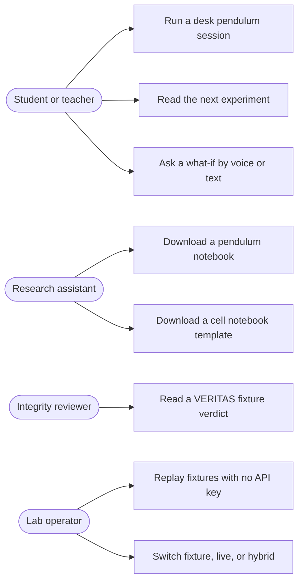
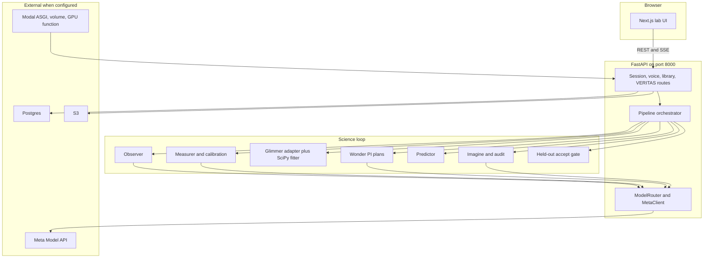
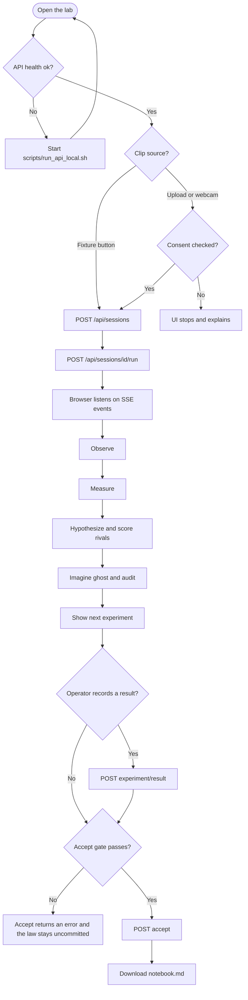
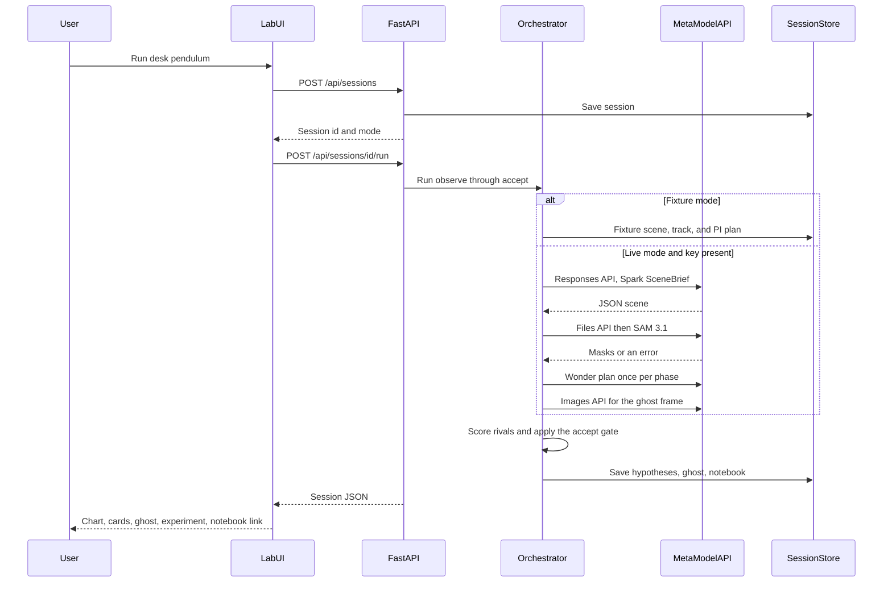

# HYPATIA

[](https://github.com/mitra9917/HYPATIA/actions/workflows/ci.yml)
[](https://www.python.org/)
[](https://fastapi.tiangolo.com/)
[](https://nextjs.org/)
[](https://dev.meta.ai/products/meta-model-api)

**The camera that does science.**

Point a camera at something that moves. HYPATIA watches it, proposes rival laws, keeps a law only when held-out maths agrees, draws the predicted future, and tells you the next experiment.

Built for the **[Meta Global AI Developer Hackathon](https://cerebralvalley.ai/e/meta-ai-developer-hackathon)** (also listed at [dev.meta.ai/events/global-hackathon](https://dev.meta.ai/events/global-hackathon)). **Indie track.** Theme: **Push the Frontier.**


The tagline used in the lab and in [`docs/PRODUCT.md`](docs/PRODUCT.md) is: *"We gave Meta's models a camera and the scientific method. It rediscovered Galileo on my desk in 90 seconds."* That sentence is a pitch line. This repository does not contain a timed log of a 90-second desk run.

### How to read status words in this README

| Word | Meaning here |
| --- | --- |
| **Used** | There is a code path that calls the tool when live mode and credentials are present. |
| **Fixture** | The default path. JSON or a formula stands in for the model. CI uses this. |
| **Scaffold** | A route, client, or provider switch exists, but the call does not yet do the full job the name suggests. |
| **Planned** | An open issue or a comment describes it. It is not a working feature. |

Snapshot date for issues, pull requests, and the project board: **2 Nov 2026**, against `main` commit `e0a3d73`.

---

## Demo and screenshots

This repository does not contain screenshots, GIFs, or a demo MP4. `*.mp4` and `*.mov` are gitignored. [`data/videos/SOURCES.md`](data/videos/SOURCES.md) lists a team B-roll path `demo/muse-code-broll.mp4`; that file is **not** in git.

What you can run today, with no API key:

```bash
cp .env.example .env
./scripts/run_api_local.sh
# second terminal
./scripts/run_web_local.sh
```

Open `http://localhost:3000`, leave fixture mode on, and run the desk pendulum demo. The UI shows a stage stepper, observer narration, a trajectory chart, rival hypothesis cards, a geometric ghost overlay, an experiment prompt, and a notebook download after the accept gate passes.

---

## Problem

Doing science on video is still a manual loop: mark the object, copy numbers into a sheet, try formulas, and guess the next experiment.

[`docs/PRODUCT.md`](docs/PRODUCT.md) names who feels that, and it cites outside figures. **Those figures are not measurements from this codebase, and this README does not re-check them:**

| Who the spec names | Pain the spec describes | Citation as written in the spec |
| --- | --- | --- |
| Students and teachers | No integrated lab around a phone camera | ~1.25 lakh Indian schools without labs (UDISE+ 2024–25) |
| Biology and materials labs | Long videos, sparse gold labels | Cell Tracking Challenge: expert labels cover ~17.8% of cells |
| Science as a system | Slow, hard to reproduce | Nature 2016 reproducibility survey (>70%); a claim that self-driving labs cut experiments ~6× |

HYPATIA's own claim, which the code does implement in fixture mode, is narrower: one camera session should run observe → measure → rival laws → held-out score → prediction → next experiment → notebook, and a law should not be accepted because a model said so.

## Solution

HYPATIA is a lab UI plus a FastAPI science loop.

1. **Observe** a clip and name what to track.
2. **Measure** motion in metres and seconds.
3. **Hypothesise** several laws and score them on held-out samples. SciPy and NumPy decide. The language model plans and narrates.
4. **Imagine** the next motion as a ghost overlay, and score that ghost against the track.
5. **Experiment**: ask for the trial that separates the rivals (for the pendulum, double the string length).
6. **Learn**: if the accept gate passes, write a markdown notebook and list the law in the library.

Live Meta models are wired behind `FIXTURE_MODE=false` and `MODEL_API_KEY`. If a live call fails, the session falls back to fixtures and can mark itself `hybrid`. See [Meta AI toolkit alignment](#meta-ai-toolkit-alignment) for what is a real call versus a stub.

## Who it is for

From [`docs/PRODUCT.md`](docs/PRODUCT.md). These are design personas, not a user count. This repo has no analytics and no reported user numbers.

| Persona | What they need | What the repo actually offers |
| --- | --- | --- |
| Student or teacher | A desk experiment, an explanation, and the next step | Pendulum fixture session, hypothesis cards, experiment text, notebook |
| Research assistant | Laws plus a notebook from a time-lapse | Cell notebook route. The markdown is a **fixed demo template**, not a fit on a microscopy file in git |
| Integrity reviewer | A physics verdict with a frame | `POST /api/veritas/analyze` reads [`data/fixtures/veritas_fake_freefall.json`](data/fixtures/veritas_fake_freefall.json) |
| Lab operator / judge | A path that still works if the network fails | Fixture mode, fixture banner, `POST /api/ops/mode` |

## Impact

The intended path in the product spec is a free web lab for school practicals, then a video notebook for research, then an API from video to checked laws. **None of that is launched here.** There is no public URL checked into the repo, no usage metric, and no deployed health URL recorded in git.

What is in the repo, and what a judge can re-run:

- A closed loop on a synthetic pendulum trajectory, with a held-out winner and a bootstrap interval on `g` (`services/api/hypatia/scoring_gate.py`, `science.py`).
- A fixture eval **catalog** (not a fresh measurement). See [Eval catalog](#eval-catalog-not-a-live-benchmark).
- Ethics consent required before upload or webcam (`upload_consent=true`, or the API returns 422).

---

## Key features

| Feature | Where | Honest limit |
| --- | --- | --- |
| Fixture end-to-end session | `POST /api/sessions` then `POST /api/sessions/{id}/run` | Default. No Meta key. |
| Webcam or file upload | `apps/web/components/WebcamCapture.tsx` | Consent checkbox required. Bytes can be copied to S3 only if AWS env vars are set; S3 errors are ignored so create still succeeds. |
| Stage machine | `observe → measure → hypothesize → imagine → experiment → accept` | A later stage returns 422 if the previous artefact is missing (`orchestrator.py`). |
| Live progress | `GET /api/sessions/{id}/events` (SSE) | Lab UI subscribes while a run is in flight. |
| Observer | `hypatia/observer.py` | Fixture `SceneBrief`, or Muse Spark Responses API with optional video `file_id`. |
| Measurer | `hypatia/measurer.py`, `sam_live.py`, `calibration.py` | Fixture mode uses a synthesized pendulum. Live mode calls SAM 3.1 when a `file_id` exists. If at least three masks decode, centroids become the SI track; otherwise the synthesized track remains. |
| Rival laws | `hypatia/science.py`, `symbolic_fitter.py` | Three pendulum forms, held-out R², winner vs eliminated. Fit is **SciPy `curve_fit`**. PySR is an optional import and is not in `requirements.txt`. |
| Accept gate | `hypatia/scoring_gate.py` | Winner must beat rivals on held-out score, `g` within ±10% of 9.80665, and a sane bootstrap interval. Otherwise `POST .../accept` fails. |
| Ghost overlay | `pipeline.py` `_imagine`, `GhostCanvas.tsx` | Fixture and failures draw a geometric polyline. Muse Image runs only in live mode. |
| Imagination audit | `imagination_audit.py` | Compares predicted boxes to mask frames (IoU and centroid metres). This is geometry on the session track, not a second live SAM call in the fixture path. |
| Next experiment | `science.propose_experiment` | Fixed pendulum instruction: double the string length; expect period × about 1.41 if `T ∝ √L`. |
| Human result | `POST .../experiment/result` | Stores the note and optional period ratio. It does not automatically re-fit. |
| Voice | `POST /api/voice/turn`, `WS /api/voice/realtime` | **Scaffold.** See the toolkit table. The mic UI exists. |
| Notebook | `GET .../notebook.md` | After accept. Cells variant: `GET .../cells-notebook.md` when the domain hint contains `cell` or starts with `biology`. |
| Law and tool library | `GET /api/library/laws`, `GET /api/library/tools` | Laws are accepted sessions in the current store (memory, unless `DATABASE_URL` is set). |
| Toolsmith test | `POST /api/toolsmith/test-promoted` | Runs a small Python snippet in a **local subprocess** with network env cleared. `modal_app.toolsmith_run` is the same idea and is documented in code as a stand-in, not `modal.Sandbox`. |
| VERITAS | `POST /api/veritas/analyze` | Always loads the fixture JSON, including when `use_fixture` is false. |
| Ops switch | `POST /api/ops/mode` | `fixture`, `live`, or `hybrid`. Live and hybrid return 422 without `MODEL_API_KEY`. |
| Spark Contributor routing | `META_USE_CONTRIBUTOR` | Observer model id only. Wonder, Image, and SAM refuse a `-contributor` id. |

---

## Use cases



| ID | Actor | Use case | Entry | Status |
| --- | --- | --- | --- | --- |
| UC1 | Student or teacher | Run observe through accept on a pendulum | Lab button or `POST /api/sessions/{id}/run` | Fixture works in CI. Live needs a key. |
| UC2 | Student or teacher | See which length change separates rival laws | Returned on the experiment stage; also `POST .../experiment/propose` | Implemented. The text is the pendulum rule in `science.py`, not a search over arbitrary domains. |
| UC3 | Student or teacher | Hands-free question while touching the apparatus | `VoiceMic` → `/api/voice/turn` or `/api/voice/realtime` | UI and routes exist. Transcript is canned. See toolkit table. |
| UC4 | Research assistant | Keep the accepted law, constants, and error bar | `GET .../notebook.md` | Works after a passing accept gate. |
| UC5 | Research assistant | Logistic-growth notebook for a cell clip | Create with `domain_hint=biology.cells`, then `GET .../cells-notebook.md` | Template constants (`r = 0.42 h⁻¹`, doubling ~1.65 h) are written in source. They are not fit from a video in git. |
| UC6 | Integrity reviewer | Flag a clip whose motion is not `g` | `POST /api/veritas/analyze` | Fixture verdict: `not_physical`, break frame 41, measured 6.1 m/s². |
| UC7 | Lab operator | Demo or CI without Meta | `FIXTURE_MODE=true` (default) | This is the supported judge-offline path. |
| UC8 | Lab operator | Flip mode without a redeploy | `POST /api/ops/mode` | In-process override. It resets when the API process restarts. |

Non-goals for v1, copied from the product spec and still true in code: no robots, no foundation-model training, no regulated metrology, and no computer-use control of a browser simulator (open issues [#38](https://github.com/mitra9917/HYPATIA/issues/38) and [#68](https://github.com/mitra9917/HYPATIA/issues/68)).

---

## System architecture



| Piece | Role in this repo |
| --- | --- |
| `apps/web` | One lab page: consent, capture, stepper, narration, chart, ghost, hypotheses, voice, library. |
| `services/api/hypatia` | Agents, maths, store, and routes. Python packages under `packages/` in the architecture doc are **not** split out; the modules live here. |
| `ModelRouter` | One place for model ids. Logs model, kind, latency, and session id. |
| `MetaClient` | OpenAI Python SDK pointed at `META_BASE_URL` (default `https://api.meta.ai/v1`). |
| Store | In-memory unless `DATABASE_URL` is set, then Postgres (`postgres_store.py`, `migrations/001_architecture_v5.sql`). Docker Compose sets the URL to the `db` service. |
| Modal | `services/api/modal_app.py` serves the same FastAPI app, mounts volume `hypatia-weights`, and defines `glimmer_swarm` plus `toolsmith_run`. |
| AWS | Optional S3 upload and a notes folder `infra/aws/`. Not the primary app host. |

Design rule, enforced by the accept gate: **the model proposes, the score decides.**

---

## Main user flow



A second path is per-stage: `POST /api/sessions/{id}/observe`, then `measure`, `hypothesize`, `imagine`, `experiment`, `accept`. `POST /api/sessions/{id}/run?from_stage=measure` resumes from a named stage if earlier artefacts exist.

---

## Pipeline


### Sequence for the core run

`POST /api/sessions/{id}/run` is one request that walks every stage. The browser also opens the SSE stream beside it; that stream is not drawn below.



Live calls that throw are caught in the pipeline. The session records the error on `meta_calls` and continues on fixtures where that fallback exists (observer scene, SAM track, geometric ghost). Accept does **not** have a fallback that ignores a failed gate.

---

## Meta AI toolkit alignment

The 2026 hackathon page asks builders to use the **Muse Spark** series, **Muse Wonder**, **Muse Image**, and **SAM 3.1** through the [Meta Model API](https://dev.meta.ai/products/meta-model-api), to run **Meta open-weight models**, and to code with **Muse Code**. Named inference partners are **Modal**, **Baseten**, and **Fireworks** ([event page](https://cerebralvalley.ai/e/meta-ai-developer-hackathon), [dev.meta.ai event](https://dev.meta.ai/events/global-hackathon)).

Official model roles: [Models](https://dev.meta.ai/docs/models). The API is OpenAI-SDK compatible: [SDKs](https://dev.meta.ai/docs/getting-started/sdks). SAM prompting: [Segmenting](https://dev.meta.ai/docs/sam/segmenting). Computer use (not implemented here): [Computer use](https://dev.meta.ai/docs/computer-use).

### Named for this hackathon

| Meta tool | What Meta describes | HYPATIA | Status |
| --- | --- | --- | --- |
| Meta Model API, Responses | Agents, structured output, files, video | `MetaClient.respond_text` via the OpenAI SDK. Base URL `https://api.meta.ai/v1`. Auth env `MODEL_API_KEY`. | **Used** when live. Health probe is `GET /api/health?meta_ping=1`. |
| `muse-spark-1.3` | Fast multimodal model, including video | Observer `SceneBrief` JSON schema. Optional `input_video` `file_id`. | **Used** live. **Fixture** by default (`data/fixtures/observer_pendulum.json`, `observer_cells.json`). |
| Spark Contributor | Cheaper Spark tier for data you allow Meta to use | `META_USE_CONTRIBUTOR=true` rewrites only the observer id to `muse-spark-1.3-contributor`. | **Used** as a switch. Off by default. Policy: [`docs/CONTRIBUTOR_ROUTING.md`](docs/CONTRIBUTOR_ROUTING.md). |
| `muse-wonder-1.0` | Long-horizon agent, tools, computer use | One plan per phase (`observe`, `measure`, `hypothesize`, `experiment`) with a JSON schema. | **Used** for plans in live or hybrid sessions. Fixture plans otherwise. **Computer use is not in the code.** |
| `muse-image-1.0` | Image generation | `images.generate` during imagine, only if the client is enabled and `session.mode == "live"`. | **Used** live. Empty or failed responses fall back to a geometric ghost. |
| `sam-3.1` | Text-prompted boxes, masks, and video tracking | Streaming Responses plus `meta_sam_parser` (`sam_live.py`, `sam_parser_bridge.py`). | **Used** live when a video `file_id` exists. Fixture mode does not call SAM. |
| `meta_sam_parser` | Official Python decode for SAM payloads | In `services/api/requirements.txt`. | **Used** on the live decode path and in unit tests. |
| Files API | Upload once, reuse `file_id` | `meta_files.py` on live session create and observe. | **Used** live. Skipped in fixture mode. |
| `muse-voice-transcribe-1.0` | Speech to text | Routes exist. `transcribe_audio_base64` decodes the bytes and then returns a **fixed sentence**. It does not call a transcribe endpoint. The WebSocket documents `wss://api.meta.ai/v1/asr/realtime` and then emits fixture partials. It never opens that socket. | **Scaffold.** A live session can still ask Wonder for an experiment reply after the canned transcript. |
| Muse Glimmer (open weights) | Self-hosted or partner-hosted model. No Model API id. | `glimmer.py` switches on `GLIMMER_PROVIDER`. Default `stub` returns a fixed rival list. `modal` calls `hypatia.glimmer_swarm`, which returns that **same static list** and does not load weights from the volume. `baseten` and `fireworks` POST JSON if URL and key are set. | **Scaffold.** The hypothesize stage does call this adapter. It is not a verified open-weight inference. |
| Muse Spark Open | Self-hosted multimodal fallback | No module, no env var. | **Not used.** Issue [#8](https://github.com/mitra9917/HYPATIA/issues/8) is closed; the project board still says Up next. |
| Muse Code | Agentic coding during the hackathon | Not a runtime dependency. Issue [#7](https://github.com/mitra9917/HYPATIA/issues/7) is closed as process evidence. The B-roll file named in `SOURCES.md` is not in git. | **Not a product feature.** Process claim only. |
| Modal | Partner credits, GPUs, sandboxes, volumes | `modal_app.py`, secret name `hypatia-secrets`, volume `hypatia-weights`. `MODAL_FINALS_WARM=1` sets `min_containers=1` on the ASGI function. | **Integration path.** Deploy is operator-run (`modal deploy`). CI deploy workflow stays a dry run unless manually dispatched with tokens. |
| Baseten | Partner open-weight hosting | HTTP client in `glimmer.py` if `GLIMMER_PROVIDER=baseten` plus `BASETEN_API_KEY` and `GLIMMER_BASETEN_URL`. | **Planned failover.** Not the default. No checked-in proof of a live endpoint. |
| Fireworks | Partner open-weight hosting | Same pattern, `GLIMMER_PROVIDER=fireworks`. Default URL in code is `https://api.fireworks.ai/inference/v1/completions`. | **Planned failover.** Same caveat. |

### Broader Meta AI stack, not named on the hackathon page

These show up often in other Meta AI guidance (Llama applications, on-device, and safety classifiers). **HYPATIA does not use them, and there is no issue that integrates them.** They are listed so a judge can see the gap on purpose.

| Toolkit | What it is | HYPATIA | Status |
| --- | --- | --- | --- |
| [Llama Stack](https://github.com/meta-llama/llama-stack) | Unified APIs for Llama inference, agents, RAG, safety, evals | No dependency or config | **Not used** |
| Llama API and Llama 4 | Hosted Llama models and the earlier Llama API | No client. This hackathon path is the Muse Model API above | **Not used** |
| PyTorch | Training and inference | Not in `requirements.txt`. The fit path is NumPy, SciPy, and OpenCV | **Not used** |
| [ExecuTorch](https://pytorch.org/executorch/stable/index.html) | On-device runtime, including a Llama Stack provider story | No mobile or edge target | **Not used.** Not planned in the board. |
| [Llama Guard and Prompt Guard](https://www.llama.com/docs/how-to-guides/prompt-guard/) | Content and prompt-injection classifiers. Llama Guard 4 is also described on [Llama protections](https://dev.meta.ai/llama/llama-protections) | No moderation call | **Not used.** Not planned in the board. |
| `@meta-sam/parser` | TypeScript SAM decode | Not in `apps/web/package.json`. Masks are drawn from API JSON | **Not used.** Python `meta_sam_parser` is the path that exists. |

PySR is **not** a Meta product. The issue title says "PySR / SciPy". The running fitter is SciPy. `optional_pysr_g` imports PySR only if someone installs it outside CI.

---

## Tech stack

| Layer | Choice in this repo |
| --- | --- |
| Lab UI | Next.js 15 App Router, React 19, TypeScript. No component library beyond the repo. |
| API | FastAPI, uvicorn, Pydantic v2. Binds `0.0.0.0:$PORT` (`PORT` default 8000). |
| Meta client | `openai` Python SDK, `base_url` = Meta Model API |
| SAM decode | `meta_sam_parser` |
| Maths and vision | NumPy, SciPy, OpenCV headless |
| Optional symbolic regression | PySR, not installed by `requirements.txt` |
| Database | Postgres 16 in Docker Compose. Driver `psycopg`. In-memory store if `DATABASE_URL` is empty. |
| Object storage | `boto3` S3, optional |
| Deploy target | Modal ASGI first. Vercel is the documented UI host (`API_ORIGIN` / `NEXT_PUBLIC_API_ORIGIN`). AWS is storage and a written fallback, not the app runtime in tree. |
| CI | GitHub Actions: pytest on fixture mode, Next.js `npm run build`. Workflows: `.github/workflows/ci.yml`, `deploy.yml`, `warm-health.yml`. |
| Local full stack | `docker-compose.yml` (Postgres + API + web) |

---

## Project structure

```text
.
├── apps/web/                  # Next.js lab (app/page.tsx, components/, lib/api.ts)
├── services/api/
│   ├── hypatia/               # FastAPI app and science modules
│   │   ├── app.py             # HTTP and WebSocket routes
│   │   ├── pipeline.py        # stage bodies
│   │   ├── orchestrator.py    # order and guards
│   │   ├── meta_client.py     # Model API
│   │   ├── model_router.py
│   │   ├── observer.py
│   │   ├── measurer.py
│   │   ├── science.py
│   │   ├── scoring_gate.py
│   │   ├── symbolic_fitter.py
│   │   ├── glimmer.py
│   │   ├── pi.py
│   │   ├── predictor.py
│   │   ├── veritas.py
│   │   ├── voice.py
│   │   ├── voice_realtime.py
│   │   ├── toolsmith/
│   │   └── domains/cells.py
│   ├── migrations/
│   ├── tests/
│   ├── modal_app.py
│   └── requirements.txt
├── data/fixtures/             # observer, SAM boxes, tracks, VERITAS, cost sample
├── data/videos/SOURCES.md     # rights table; video binaries are not in git
├── demo/DEMO_SCRIPT.md
├── docs/                      # product, architecture, deploy, playbook map
├── evals/                     # fixture catalog runner
├── infra/aws/                 # notes, not a full Terraform app
├── scripts/                   # local API, smokes, project-board helpers
├── .env.example
├── docker-compose.yml
└── meta_evidence.json
```

There is no `packages/` tree and no `LICENSE` file.

---

## Getting started

### Prerequisites

- Python 3.12 (the version CI installs)
- Node.js 22 (the version CI installs)
- npm
- Optional: Docker, for Postgres + API + web together
- Optional, for live Meta: a Model API key from [dev.meta.ai](https://dev.meta.ai)
- Optional, for Modal: the Modal CLI and a token

### Install and run the fixture lab

```bash
cp .env.example .env
cp apps/web/.env.local.example apps/web/.env.local
./scripts/run_api_local.sh
```

`run_api_local.sh` installs `services/api/requirements.txt` and listens on `0.0.0.0:8000`.

Second terminal:

```bash
cd apps/web
npm ci
npm run dev
```

UI: `http://localhost:3000`. Health: `http://127.0.0.1:8000/api/health`.

`apps/web/.env.local` should set `NEXT_PUBLIC_API_ORIGIN=http://127.0.0.1:8000` so long runs do not depend on the Next.js rewrite proxy.

Docker:

```bash
docker compose up --build
```

Compose starts Postgres 16, runs migrations, then the API and the web app. Web: `http://localhost:3000`.

### Environment variables

Names only. Values stay in `.env`, which is gitignored. Defaults live in `.env.example`.

| Name | Purpose |
| --- | --- |
| `MODEL_API_KEY` | Bearer token for Meta Model API. Empty means fixture behaviour. |
| `META_BASE_URL` | Default `https://api.meta.ai/v1` |
| `META_OBSERVER_MODEL` | Default `muse-spark-1.3` |
| `META_PI_MODEL` | Default `muse-wonder-1.0` |
| `META_IMAGE_MODEL` | Default `muse-image-1.0` |
| `META_SAM_MODEL` | Default `sam-3.1` |
| `META_VOICE_MODEL` | Default `muse-voice-transcribe-1.0` (the id is configured; the transcribe call is still a stub) |
| `META_USE_CONTRIBUTOR` | `true` only to route Observer Spark to the contributor id |
| `FIXTURE_MODE` | Default `true` |
| `FIXTURE_RECORD` | When live, write captured observer output under `data/fixtures/` |
| `GLIMMER_PROVIDER` | `stub` (default), `modal`, `baseten`, or `fireworks` |
| `GLIMMER_BASETEN_URL` | Required with Baseten provider |
| `GLIMMER_FIREWORKS_URL` | Optional override |
| `BASETEN_API_KEY` | Baseten provider |
| `FIREWORKS_API_KEY` | Fireworks provider |
| `MODAL_TOKEN_ID` | Modal CLI / deploy |
| `MODAL_TOKEN_SECRET` | Modal CLI / deploy |
| `MODAL_FINALS_WARM` | `1` / `true` / `yes` keeps one Modal ASGI container warm. Read at deploy time inside `modal_app.py`. |
| `DATABASE_URL` | Postgres. Empty selects the in-memory store. |
| `AWS_REGION` | Default `ap-south-1` |
| `AWS_ACCESS_KEY_ID` | S3 |
| `AWS_SECRET_ACCESS_KEY` | S3 |
| `S3_BUCKET` | S3 |
| `CORS_ORIGINS` | Comma-separated browser origins |
| `PORT` | API port, default 8000 |
| `API_ORIGIN` | Used by the web image / server to find the API |
| `NEXT_PUBLIC_API_ORIGIN` | Browser-side API origin (`apps/web/.env.local`) |

Do not commit `.env`.

### Live Meta mode

```bash
# in .env
# MODEL_API_KEY=<your key>
# FIXTURE_MODE=false
./scripts/run_api_local.sh
python scripts/smoke_meta_api.py
```

`smoke_meta_api.py` is the explicit opt-in smoke. CI does not call Meta.

### Tests

API (fixture, no key):

```bash
cd services/api
PYTHONPATH=. FIXTURE_MODE=true python -m pytest -q
```

Web production build, from `apps/web`:

```bash
npm ci && npm run build
```

Other checks used in CI and docs:

```bash
bash scripts/verify_video_corpus.sh
bash scripts/verify_modal_integration.sh
bash scripts/verify_github_actions_secrets.sh
bash scripts/verify_playbook_58_62.sh
python3 -m evals --suite desk-mechanics --mode fixture
python3 scripts/cost_report.py
```

`--mode live` on the eval runner exits immediately and tells you to use `scripts/smoke_meta_api.py`. It does not score live video.

---

## API reference

Base URL locally: `http://127.0.0.1:8000`. Interactive schema: `/docs` (FastAPI).

| Method | Path | What it does |
| --- | --- | --- |
| GET | `/api/health` | Liveness, fixture flag, model ids, glimmer probe, store kind. `?meta_ping=1` calls Meta if a key exists. |
| POST | `/api/ops/mode` | Body `{"mode":"fixture"\|"live"\|"hybrid"}`. |
| POST | `/api/sessions` | Multipart create. Fields: `file`, `source_type` (`webcam` or `upload`), `upload_consent`, `consent_version`, query `domain_hint`. |
| GET | `/api/sessions/{id}` | Session plus `law_gate`. |
| GET | `/api/sessions/{id}/events` | SSE (`snapshot`, stage events, keepalive). |
| POST | `/api/sessions/{id}/observe` | One stage. |
| POST | `/api/sessions/{id}/measure` | One stage. |
| POST | `/api/sessions/{id}/hypothesize` | One stage. |
| POST | `/api/sessions/{id}/imagine` | One stage. |
| POST | `/api/sessions/{id}/experiment` | One stage (PI narration plus proposal). |
| POST | `/api/sessions/{id}/experiment/propose` | Proposal only. Requires hypotheses. |
| POST | `/api/sessions/{id}/experiment/result` | JSON body: notes and optional `observed_period_ratio`. |
| POST | `/api/sessions/{id}/accept` | Notebook if the gate passes. |
| POST | `/api/sessions/{id}/run` | Full loop. Query `from_stage` to resume. Query `domain_hint` optional. |
| GET | `/api/sessions/{id}/notebook.md` | Markdown download after accept. |
| GET | `/api/sessions/{id}/cells-notebook.md` | Cell template if the domain matches. |
| GET | `/api/sessions/{id}/imagination/{index}/frame.png` | Ghost image bytes if imagine saved one. |
| GET | `/api/sessions/{id}/tracks/{track_index}/trajectory.csv` | CSV after measure. |
| POST | `/api/voice/turn` | JSON: `session_id`, `transcript`, and/or `audio_base64`. |
| WS | `/api/voice/realtime` | Query `session_id`. Fixture stream. |
| GET | `/api/library/laws` | Accepted notebooks currently in the store. |
| GET | `/api/library/tools` | Promoted tools. |
| POST | `/api/toolsmith/test-promoted` | Local subprocess test on a fixture track. |
| POST | `/api/veritas/analyze` | Fixture physics verdict. No request body. |

Stage routes return 404 if the session is missing and 422 if a prior stage did not leave the required artefact.

---

## Eval catalog, not a live benchmark

`python3 -m evals --suite desk-mechanics --mode fixture` **replays** [`evals/suites/desk-mechanics.json`](evals/suites/desk-mechanics.json). It does not open a video, call a model, or re-fit `g`. The checked-in summary is [`evals/results/20261102_summary.md`](evals/results/20261102_summary.md) (generated 2026-11-02).

| Clip id in the catalog | Declared true law | Declared recovered row | Declared key constant | Declared ghost MAE |
| --- | --- | --- | --- | --- |
| `pendulum_desk_fixture` | `T = 2π√(L/g)` | same | `g ≈ 9.8 ± 0.4 m/s²` | 0.011 m |
| `pendulum_length_sweep` | `T ∝ √L` | `T = 2π√(L/g)` | `g ≈ 9.6–10.1 m/s²` | 0.014 m |
| `ai_fake_freefall_veritas` | uniform `g ≈ 9.8` | VERITAS `not_physical` at frame 41 | measured 6.1 m/s² | none |

The held-out pass flags in that file are part of the catalog (`true` for all three rows). They are not an independent pass rate measured by this README.

Separate from that catalog, unit tests do execute the fitter and the accept gate on synthesized pendulum samples (`services/api/tests/test_scoring_gate.py`, `test_symbolic_fitter.py`, `test_accept_gate.py`). Those tests check code behaviour. They are not a published accuracy table on real desk video. The desk MP4s named in `SOURCES.md` are not in git, so this README cannot report results on them.

`scripts/cost_report.py` summarizes a **sample** log at `data/fixtures/cost_report_sample.json`. It is not a bill. The hackathon brief in-repo cites about $150 of Model API credits per participant; that number comes from event materials, not from a HYPATIA invoice in git.

---

## Roadmap and project status

Work is tracked on the public board **[HYPATIA Build Playbook](https://github.com/users/mitra9917/projects/4)** (GitHub Projects v2, project number 4, owner `mitra9917`). **Playbook number and issue number are different.** The map is [`docs/PLAYBOOK_ISSUE_MAP.md`](docs/PLAYBOOK_ISSUE_MAP.md). Daily rule in the board description: one card in progress, then the next lowest playbook number.

Queried **2 Nov 2026**:

| Source | Count |
| --- | --- |
| Board items | 67 |
| Board status Done | 54 |
| Board status Up next | 11 |
| Board status empty | 2 ([#25](https://github.com/mitra9917/HYPATIA/issues/25), [#34](https://github.com/mitra9917/HYPATIA/issues/34)) |
| GitHub issues open | 6 |
| GitHub issues closed | the rest of issues #2–#68 (issue #1 was the planning PR, not an issue in this list) |
| Pull requests | 29 merged, 0 open |

The board **Status** field is behind GitHub on several cards that code already merged. Treat **issue state** as the tracker of record, and the board as the ordered playbook.

### Milestones

Milestone objects on GitHub are still `open` even where every child issue is closed.

| Milestone | Intent | Issues on 2 Nov 2026 |
| --- | --- | --- |
| [M0 — Docs and integration spine](https://github.com/mitra9917/HYPATIA/milestone/1) | Keys, Modal, Postgres, partners | 13 closed, 1 open: [#44](https://github.com/mitra9917/HYPATIA/issues/44) (coverage checklist). Board status for #44 is Done. |
| [M1 — Perception E2E](https://github.com/mitra9917/HYPATIA/milestone/2) | Upload or webcam through tracks and the lab shell | 16 closed, 0 open |
| [M2 — First law](https://github.com/mitra9917/HYPATIA/milestone/3) | Rivals, PI plan, held-out gate, hypothesis UI | 10 closed, 0 open |
| [M3 — Ghost and experiment](https://github.com/mitra9917/HYPATIA/milestone/4) | Ghost, experiment, voice routes | 11 closed, 0 open |
| [M4 — Deploy, evals, submit](https://github.com/mitra9917/HYPATIA/milestone/5) | Public URL, eval table, 3-minute video, form | 11 closed, 5 open (below) |

---

## Team and contributing

Git history on `main` at this snapshot is authored as **mitra9917**, **Shubham**, and **Cursor Agent** (the last is the cloud-agent committer string). That is a commit-author list, not a staffing chart. The GitHub project owner is [mitra9917](https://github.com/mitra9917). Product docs also refer to the builder as Mitrazzz.

Hackathon rules in [`docs/HACKATHON_BRIEF.md`](docs/HACKATHON_BRIEF.md) cap a team at four. This README does not add people beyond the names already in git and in those docs.

To contribute:

1. Read [`docs/INDEX.md`](docs/INDEX.md) and [`AGENTS.md`](AGENTS.md).
2. Pick the lowest unfinished playbook issue. Do not assume playbook N is issue N.
3. Keep fixture mode green. Do not put secrets in git.
4. Do not accept a law in code without the held-out gate.
5. If you change behaviour, update the matching doc under `docs/`.

This public repository is the submission surface. Event window in the docs: **26 Oct 2026 through 4 Nov 2026 (ET).**

---

## License

The previous README and [`docs/HACKATHON_ALIGNMENT.md`](docs/HACKATHON_ALIGNMENT.md) say the project is **MIT**. **There is no `LICENSE` file in the repository** as of commit `e0a3d73`, so this README does not claim a legally attached license. Third-party clips, if added later, must be listed in [`data/videos/SOURCES.md`](data/videos/SOURCES.md). Fixture JSON in `data/fixtures/` is project data for replay.

---

## Acknowledgements

- [Meta Model API](https://dev.meta.ai/products/meta-model-api) and the Muse and SAM model docs used as the integration target.
- Hackathon partners named by Meta for open weights and GPUs: [Modal](https://modal.com), [Baseten](https://www.baseten.co), [Fireworks](https://fireworks.ai). HYPATIA's default path does not call them until env vars say so.
- Event host pages: [Cerebral Valley](https://cerebralvalley.ai/e/meta-ai-developer-hackathon) and [Meta's event page](https://dev.meta.ai/events/global-hackathon).
- Runtime libraries the code imports: FastAPI, Uvicorn, Pydantic, the OpenAI Python SDK (as the HTTP client), NumPy, SciPy, OpenCV, psycopg, boto3, Modal's Python SDK, and `meta_sam_parser`.
- UI: Next.js and React.

---

## Where to go next in the repo

| Question | Document |
| --- | --- |
| Product scope and non-goals | [`docs/PRODUCT.md`](docs/PRODUCT.md) |
| Agents and data model | [`docs/ARCHITECTURE.md`](docs/ARCHITECTURE.md) |
| Per-model call shapes | [`docs/META_TOOLING.md`](docs/META_TOOLING.md) |
| Evidence table the team maintains | [`docs/META_EVIDENCE.md`](docs/META_EVIDENCE.md) |
| Deploy order | [`docs/DEPLOYMENT.md`](docs/DEPLOYMENT.md) |
| What fails and the fallback | [`docs/RISKS.md`](docs/RISKS.md) |
| 3-minute shot list | [`demo/DEMO_SCRIPT.md`](demo/DEMO_SCRIPT.md) |
